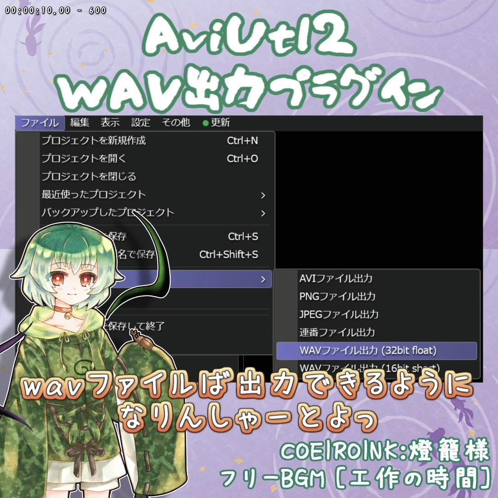

# WAVファイル出力

* aviutl2用の出力プラグインです。
* 音声のみを32bit floatまたは16bit shortのWAV形式で出力します。 

## 📺ニコニコ動画

* 親登録用のニコニコ動画です。
* 親登録は任意ですが、して頂けると作者の収入になるので、非常に助かります。
* ご負担でなければ、よろしくお願いします。
* [ニコニコの収入](https://x.com/search?q=%23%E3%83%8B%E3%82%B3%E3%83%8B%E3%82%B3%E3%81%AE%E5%8F%8E%E5%85%A5&f=live)はXでつぶやいていることがあります。

## インストール

* `C:\ProgramData\aviutl2\Plugin`フォルダに以下のファイルを入れてください。
	* `al2_wav_saver_s16.auo2` (16bit shortで出力したい場合)
	* `al2_wav_saver_f32.auo2` (32bit floatで出力したい場合)
* 片方だけでも動作するので、必要ない方は入れなくても大丈夫です。

## アンインストール

* `C:\ProgramData\aviutl2\Plugin`フォルダから以下のファイルを削除してください。
	* `al2_wav_saver_s16.auo2`
	* `al2_wav_saver_f32.auo2`

## 更新履歴

* 🔖r3 🗓️2025.07.14 ♻️標準ライブラリを使用しないように変更
* 🔖r2 🗓️2025.07.14 ✨16bit shortでも出力できるように変更
* 🔖r1 🗓️2025.07.14 🎉初版

## 動作確認

* AviUtl ExEdit2 beta2 https://spring-fragrance.mints.ne.jp/aviutl/

## クレジット

* AviUtl ExEdit2 Plugin SDK https://spring-fragrance.mints.ne.jp/aviutl/

## 作成者情報
 
* 作成者 - 蛇色 (へびいろ)
* GitHub - https://github.com/hebiiro
* X - https://x.com/io_hebiiro

## 免責事項

この作成物および同梱物を使用したことによって生じたすべての障害・損害・不具合等に関しては、私と私の関係者および私の所属するいかなる団体・組織とも、一切の責任を負いません。各自の責任においてご使用ください。
